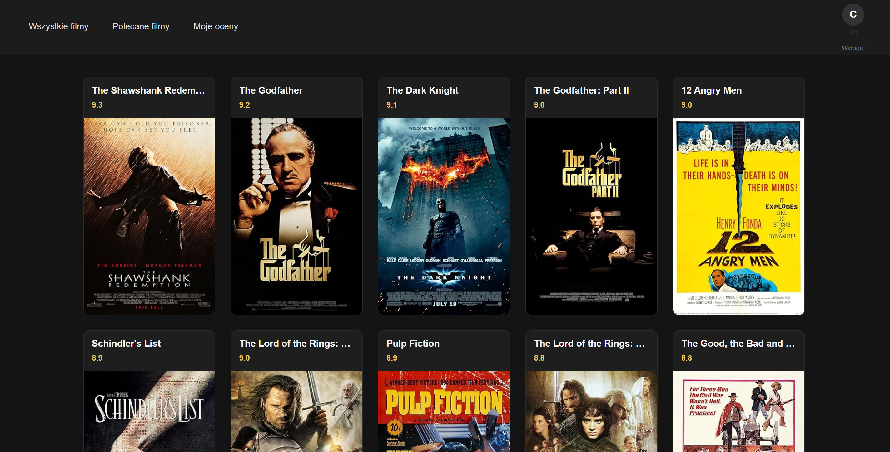
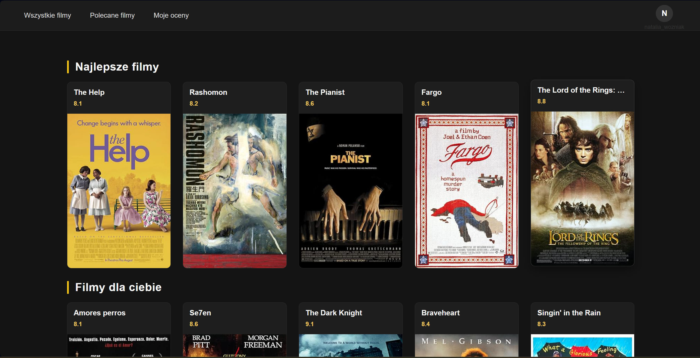
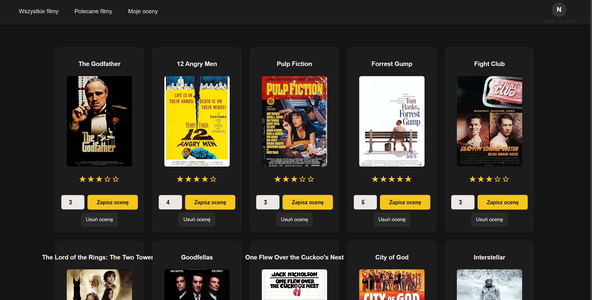

# Movies Recommendation

A learning project built with **Python, Flask, SQLite, and JavaScript** to explore web application development and personalized movie recommendations.

The application lets users log in, rate movies, delete their ratings, and receive movie recommendations based on rating patterns. Its recommendation engine implements **item-based collaborative filtering** using cosine similarity.

**Repository:** https://github.com/lookwen/movies-recommendation

## Features

- **User authentication:** Log in to an account.
- **Movie ratings:** Rate movies and manage existing ratings.
- **Delete ratings:** Remove ratings previously submitted by a user.
- **Personalized recommendations:** Generate movie recommendations using item-based collaborative filtering.

## Screenshots





## Tech Stack

| Area | Technology |
| --- | --- |
| Backend | Python, Flask |
| Frontend | JavaScript, HTML, CSS |
| Database | SQLite |
| Recommendation engine | NumPy, item-based collaborative filtering |
| Containerization | Docker, Docker Compose |
| Testing | pytest |

## How the Recommendation Engine Works

The recommender uses **item-based collaborative filtering**: rather than comparing users directly, it estimates how similar movies are based on the ratings they have received.

At a high level:

1. Build a user–movie rating matrix. Missing ratings are treated as unknown, not as zero-star ratings.
2. Calculate similarity between pairs of movies using **cosine similarity** on ratings from users who rated both movies.
3. Use similarities to estimate how much a user might like movies they have not rated.
4. Rank unseen movies by predicted rating to produce recommendations.

The implementation centers ratings around a neutral baseline of **3** and uses a similarity-weighted prediction. Pairs of movies with fewer than **three common raters** are not assigned a positive similarity score by the similarity calculation; when there is insufficient usable similarity information, the prediction falls back to the baseline.

This is an educational implementation, not a validated production recommendation system. In particular, recommendation quality depends on the amount and coverage of rating data, and synthetic ratings do not establish real-world recommendation accuracy.

## Dataset

- **Movie metadata:** Sourced from the public [toedter/movies-demo](https://github.com/toedter/movies-demo) repository. Credit for the original movie dataset belongs to its respective authors and sources.
- **Users and ratings:** Generated using a script for development and testing purposes.

The generated user and rating data are **synthetic** and should not be interpreted as real user behavior.

## Project Structure

The repository is organized around these main directories:

```text
movies-recommendation/
├── backend/       # Backend logic, recommendation code, and database files
├── frontend/      # Flask application and web interface
├── data/          # Project data
├── tests/         # Automated tests
├── Dockerfile     # Docker image definition
└── docker-compose.yaml   # Docker Compose configuration
```

> This is a high-level overview of the project layout; individual files may vary.

## Getting Started with Docker

### Prerequisites

- [Docker](https://docs.docker.com/get-docker/) with Docker Compose support
- Git

### Run the application

1. Clone the repository:

   ```bash
   git clone https://github.com/lookwen/movies-recommendation.git
   cd movies-recommendation
   ```

2. Build and start the application:

   ```bash
   docker compose up --build
   ```

3. Open **http://localhost:5000** in your browser.

4. Stop the application with `Ctrl+C`, or from another terminal:

   ```bash
   docker compose down
   ```

For subsequent launches, when the application image does not need to be rebuilt, run:

```bash
docker compose up
```

### SQLite data persistence

The Docker Compose setup can mount the local database directory into the container, for example:

```yaml
volumes:
  - ./backend/database:/app/backend/database
```

This keeps SQLite files on the host when containers are removed. Ensure the required database files and schema are available before starting the application. **Do not publish real user databases, credentials, or secrets to a public repository.**

> The Docker instructions assume the repository includes the `Dockerfile` and `compose.yaml` discussed above and that the Flask application listens on port 5000. If the repository configuration differs, adjust the commands accordingly.

## Testing

The project uses **pytest** for automated testing, including tests of recommendation behavior.

To run tests in a local Python environment with the project's dependencies installed:

```bash
python -m pytest
```

## Limitations and Potential Improvements

- **Cold start:** Recommendations are less informative when users or movies have few ratings.
- **Synthetic data:** Generated ratings are useful for exercising the system but cannot demonstrate recommendation quality with real users.
- **Sparse rating matrix:** Similarity estimates may be unavailable when too few users have rated the same pair of movies.
- **Future work:** Evaluate recommendations on a suitable real-world dataset, improve cold-start handling, and expand automated test coverage.

## Project Purpose

This project was created to practice:

- Building a web application with Flask and JavaScript.
- Working with relational data in SQLite.
- Implementing a recommendation algorithm with NumPy.
- Writing automated tests.
- Packaging and running an application with Docker.

## Data Attribution

Movie metadata is based on the public [toedter/movies-demo](https://github.com/toedter/movies-demo) repository. Consult the upstream repository for information about the original data and applicable licensing or attribution requirements.
